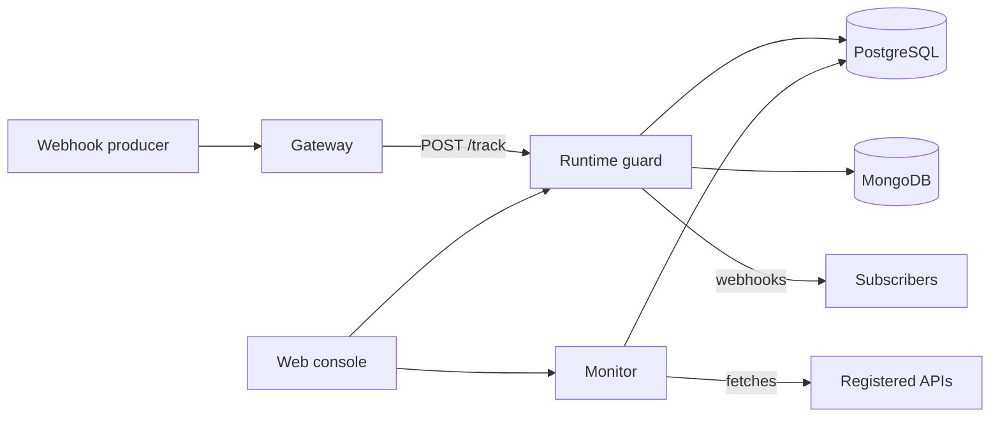

# driftgate

driftgate detects changes in the shape of JSON APIs. It infers a schema from payloads it receives or fetches, compares
it with the previous one, classifies the differences, and notifies subscribed consumers by webhook. It runs locally with
Docker Compose; there is no hosted deployment.

## Components

| Directory | Service | Host port | Role |
| --- | --- | --- | --- |
| `gateway/` | Node.js, Fastify | 8303 | Verifies the HMAC signature and idempotency key of incoming webhooks and forwards them to the runtime guard |
| `app/` | Runtime guard, FastAPI | 8302 | Versions schemas per route, classifies drift, delivers webhooks, keeps dead-letter queues, runs contract reviews |
| `backend/` | Monitor, FastAPI | 8301 | Fetches the APIs listed in `config/apis.yaml` on demand, diffs their response schemas, writes changelogs |
| `frontend/` | Angular 20, nginx | 5173 | Web console over both APIs |
| `simulator/` | FastAPI | 8001 | Test API whose response schema changes every 10 minutes |

PostgreSQL (host port 55433) holds two databases: `driftgate` for the monitor and `driftgate_runtime` for the runtime
guard. MongoDB (27017) stores payload captures, diff documents, validation errors, replay records and reviews.



## How drift detection works

Runtime guard (`POST /track`):

1. The payload is converted to a canonical schema (field names, JSON types, null) and hashed with SHA-256.
2. A hash not seen before on that route becomes a new schema version. A PostgreSQL advisory lock per route serialises version
   creation.
3. The new version is diffed against the previous one. Each change is classified as `SAFE`, `BACKWARD_COMPATIBLE`,
   `FORWARD_COMPATIBLE`, `RISKY` or `BREAKING`, and the most severe one labels the version. Removing a field or changing
   its type is breaking; integer to number is risky.
4. For each matching subscription an outbox row is written and, by default, delivered inline once. A failed delivery goes
   to the webhook dead-letter queue, from which it can be replayed.
5. A drift event goes to the configured event backend. Publish failures go to a separate dead-letter queue.

`/track` also keeps an older set of tables up to date, comparing each payload with the first schema seen for the route.
Its `SAFE`, `RISKY` and `BREAKING` counts are returned as `severities`. Requests whose namespace starts with `k6` skip
that second write and the document store.

Monitor (`POST /api/monitor/run-once`): fetches every active API concurrently, stores one snapshot per endpoint, infers a
per-path schema (type, nullability, array item type, small string enums) and records differences from the previous
successful snapshot as `breaking`, `risky` or `safe` using the table in `backend/app/core/severity.py`. Only one run can
be active at a time. A changelog for a snapshot is generated from a template, or by Claude when `ANTHROPIC_API_KEY` is
set. Model output is rejected in favour of the template if it quotes a dotted or indexed field path that is not in the
diff.

## Contract review

`POST /api/v1/ai/contract-review` runs a LangGraph pipeline over the stored evidence for one runtime endpoint: schema
diffs, payload snapshots, validation errors, subscriptions, delivery attempts and dead-letter entries. The default
reviewer is rule based and needs no model. A review whose evidence lines do not cite collected evidence is replaced by the
rule-based one.

The provider is chosen from environment variables on the runtime guard: `AI_PROVIDER` (`ollama`, `fake`),
`OPENAI_API_KEY`, `GEMINI_API_KEY`, `OLLAMA_BASE_URL`, `AI_MODEL`, `AI_TIMEOUT_SECONDS`. Setting an OpenAI or Gemini key
selects that provider even when `AI_PROVIDER` is `disabled`, and sends the evidence, including payload data, to it. The
Compose file does not pass any of these through.

## Running it

Requires Docker with Compose.

```bash
docker compose up -d --build
curl -X POST http://localhost:8301/api/monitor/run-once \
  -H "X-DRIFTGATE-ADMIN-SECRET: dev-secret"
```

The console is at `http://localhost:5173`. The monitor run calls the three public APIs in `config/apis.yaml` and the local
simulator. Defaults can be overridden in `.env`; see `.env.example`.

Send a signed webhook through the gateway:

```bash
body='{"order_id": 1, "amount": 42}'
sig=$(printf '%s' "$body" | openssl dgst -sha256 -hmac dev-webhook-secret | awk '{print $NF}')
curl -X POST http://localhost:8303/webhooks/shop \
  -H "content-type: application/json" \
  -H "x-signature: $sig" \
  -H "idempotency-key: demo-1" \
  -d "$body"
```

Prometheus (port 9090) and Grafana (port 3000, `admin` / `admin`) are in a second Compose file:

```bash
docker compose -f docker-compose.yml -f docker-compose.observability.yml up -d --build
```

## API

Both FastAPI services publish interactive documentation at `/docs`.

| Service | Routes |
| --- | --- |
| Gateway | `POST /webhooks/:source`, `GET /health` |
| Runtime guard | `POST /track`, `GET /metrics` (Prometheus), `GET /api/v1/metrics` (JSON) |
| | `GET`, `POST /api/v1/subscriptions`; `GET`, `PATCH /api/v1/subscriptions/{id}` |
| | `POST /api/v1/ai/contract-review`, `GET /api/v1/ai/contract-reviews` |
| | `/api/v1/webhook-dlq`, `/api/v1/drift-event-dlq` (list, read, `POST {id}/replay`) |
| | `GET /api/v1/webhook-delivery-attempts`, `GET /api/v1/documents/...` |
| Monitor | `GET /health`, `GET /api/endpoints`, `.../{id}`, `.../{id}/snapshots`, `.../{id}/diffs`, `.../{id}/changelogs` |
| | `GET /api/diffs/recent`, `GET /api/monitor-runs`, `GET /api/changelogs/{id}` |
| | `POST /api/monitor/run-once`, `POST /api/changelogs/generate` (admin secret) |

The `x-signature`, `x-hub-signature-256` and `x-webhook-signature` headers are accepted by the gateway, with or without a
`sha256=` prefix.

## Testing

Backend unit tests need no database:

```bash
cd backend
python3.11 -m venv .venv && . .venv/bin/activate
pip install -r requirements-dev.txt
pytest
```

Runtime tests need PostgreSQL and delete the data in the target database. From the repository root, in a separate
environment:

```bash
python3.11 -m venv .venv && . .venv/bin/activate
pip install -r requirements.txt
docker compose up -d postgres
python -m pytest tests
```

Gateway and console (the console tests need Chrome):

```bash
cd gateway && npm ci && npm test && npm run build
cd frontend && npm ci && npm run lint && npm test -- --watch=false --browsers=ChromeHeadless && npm run build
```

GitHub Actions runs these suites and builds the backend, gateway, frontend and simulator images.

## Other tools

- `scripts/openapi_diff.py --old a.json --new b.json` compares the component schemas of two OpenAPI documents (top-level
  properties only) and exits non-zero on a breaking change.
- `scripts/contract_review_agent.py --old a.json --new b.json` renders the same kind of comparison as a pull request
  comment. It is deterministic and calls no model.
- `scripts/contract_review_eval.py` scores the rule-based reviewer on 15 hand-written cases defined in the script.

## Load tests

`k6/` holds three scripts. `scripts/run_k6_benchmark.py` runs `k6/trackProfile.js` with a local `k6` binary, or the
`grafana/k6` image (in which case pass `--track-url http://host.docker.internal:8302/track` on Docker Desktop).
`make simulate` clears the legacy tables, sends 5,000 requests and overwrites `docs/benchmarks/simulation5000.json`.

The recorded results are historical. They were committed on 27 May 2026 against an earlier revision of the code and have
not been reproduced since.

| File in `docs/benchmarks/` | Load | Failed requests | Throughput | Latency |
| --- | --- | --- | --- | --- |
| `k6Smoke.json` | 100 requests, 5 virtual users | 0 | 51 req/s | p95 266 ms |
| `k6Baseline50Vus.json` | 5,000 requests, 50 virtual users | 0 | 69 req/s | p95 1.66 s, p99 2.25 s |
| `simulation5000.json` | 5,000 requests, concurrency 200 | 0 | not recorded | 37 s in total |

The k6 scripts use a `k6` namespace, which makes `/track` skip the legacy write and the document store, so they do not
measure the full request path.

## Limitations

- Only the admin routes of the monitor are authenticated. Anyone who can reach the other ports can create subscriptions
  (including webhooks to internal addresses), replay deliveries and read stored payloads. The monitor also returns the
  configured request headers, with environment variables expanded, from `GET /api/endpoints`.
- The Compose defaults (secrets, database password, unauthenticated MongoDB, ports on all interfaces) are for local use.
- The console lists monitor endpoints, but contract reviews and subscriptions use runtime guard endpoint IDs, and the
  runtime guard has no route that lists them. Generating a review from the console therefore fails with "endpoint not
  found".
- A route that returns to a schema it had before is not reported as a change.
- Array elements are compared by position, so a shorter array is reported as removed fields. The runtime guard does not
  infer enums or required fields.
- Inline webhook delivery makes the HTTP call during the `/track` request and does not retry. Retries with backoff happen
  only with `INLINE_WEBHOOK_DELIVERY=false`. With more than one worker process the outbox can deliver a message twice,
  and a row left in `DELIVERING` after a crash is not picked up again.
- Gateway idempotency keys are held in memory: they are lost on restart, grow without bound, and two simultaneous requests
  with the same key can both pass.
- The Azure Service Bus adapter needs a sender object supplied in code. No sender is wired in, so
  `EVENT_BACKEND=azure_service_bus` stops the runtime guard at startup.
- A monitor run that fails part way is rolled back and leaves no run record.
- The monitor has no scheduler.
- Runtime dependencies in `requirements.txt` are not pinned.
- There is no license file.
